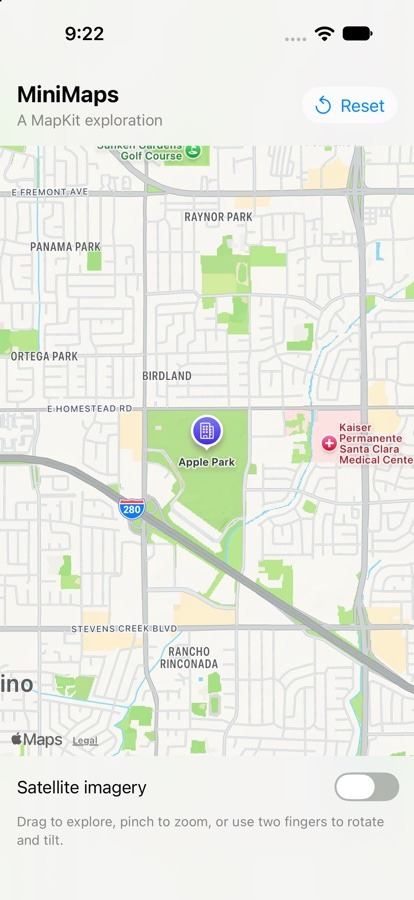
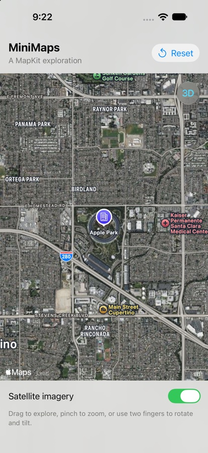

# MiniMaps

A personal SwiftUI and MapKit learning project targeting iOS 17 or later.

## Milestone 1

- Interactive map initially centered on Apple Park.
- A labeled marker at Apple Park.
- Standard and satellite map styles.
- Compass, pitch control, and scale.
- Animated reset to the starting region.
- Adaptive SwiftUI layout using system materials and text styles.

## Screenshots

Captured from MiniMaps running on the iPhone 18 Pro simulator (iOS 27.0).

| Standard map | Satellite imagery |
| --- | --- |
|  |  |

## Run

1. Open `MiniMaps.xcodeproj` in Xcode.
2. Select the MiniMaps scheme and an iPhone simulator.
3. Press Command-R.

For a physical device, select your development team in Signing & Capabilities and use your own unique bundle identifier if required. No API key or location permission is needed for this milestone. Map tiles and imagery require network access.

## Understand the code

`MiniMapsApp.swift` supplies the app entry point and window. `ContentView.swift` owns the map UI:

- `MKCoordinateRegion` describes the initial center and geographic span.
- `MapCameraPosition` describes the map camera. Passing `$position` to `Map` creates a binding so both gestures and code can update it.
- `Marker` adds a labeled geographic point.
- `mapStyle` switches presentation without replacing the map.
- `safeAreaInset` reserves space for controls without covering the central map content.

Apple's introduction: https://developer.apple.com/videos/play/wwdc2023/10043/

## Manual checks

- Launch: Apple Park and its marker are visible.
- Pan, pinch, rotate, and tilt; tap Reset and confirm the initial region returns.
- Switch satellite imagery on and off; verify camera position remains usable.
- Rotate the device and try larger accessibility text sizes.
- Enable VoiceOver and verify Reset and Satellite imagery are labeled.
- Try a fresh launch without network access; observe missing tiles, then reconnect and verify recovery. Map tile loading has no app-level error UI in this milestone.

## Validation status

The app was built and launched through Xcode on the iPhone 18 Pro simulator (iOS 27.0). Standard and satellite map rendering were visually checked and captured. The full manual checklist above remains to be completed. Command-line verification in the restricted agent session was blocked by SwiftUI macro-plugin and CoreSimulator access errors.

## Next milestones

1. Place search with `MKLocalSearch` and selectable result markers.
2. On-demand location access with Core Location, including denied/restricted states.
3. Driving directions with `MKDirections`, route overlays, and cancellation/error handling.
4. Documented edge-case testing and screenshots from the running app.
