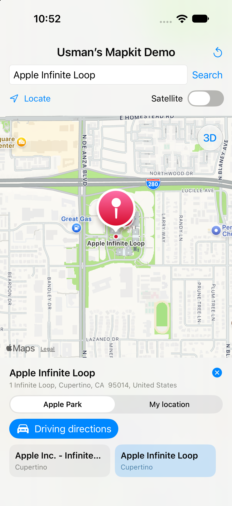
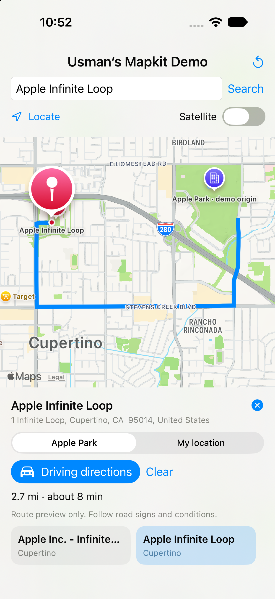
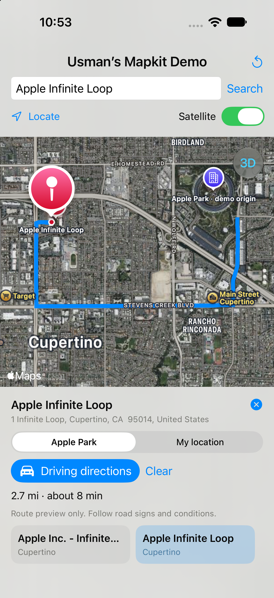

# Usman's Mapkit Demo

A native iOS learning app built with SwiftUI, MapKit, and Core Location. Target: iOS 17+.

## Features

- Interactive standard and satellite maps, compass, pitch controls, and reset to Apple Park.
- Place/address search with `MKLocalSearch`, result cards, and selectable markers.
- On-demand, when-in-use location access with denied/restricted/unavailable states and timeout handling.
- Driving directions with `MKDirections`, a route polyline, distance, and estimated time.
- Route origin choice: Apple Park for a permission-free demo, or a fresh device location after tapping Locate.
- Cancellable searches/routes, with generation checks that prevent obsolete responses updating the UI.

This is a route preview and API exploration app, not turn-by-turn navigation. Search and route requests use Apple's services; the app has no custom backend or location history. No background location permission is requested.

## Run

1. Open `MiniMaps.xcodeproj` in Xcode.
2. Select the MiniMaps scheme and an iPhone simulator.
3. Press Command-R.

For a physical iPhone, select your development team in Signing & Capabilities. No API key is required. Search, directions, and uncached map tiles need network access.

## Try it

Search **Apple Infinite Loop**, select a result card or marker, leave **Apple Park** selected as the origin, and tap **Driving directions**. To route from a device location, tap **Locate**, grant permission, choose **My location**, and request directions. Simulator location must be configured for a successful fix.

## Code guide

- `MiniMapsApp.swift`: application entry point.
- `ContentView.swift`: map, search controls, destination selection, route and status UI.
- `MapModel.swift`: search/directions lifecycle, request cancellation, Core Location authorization and one-shot fixes. Published UI state is owned by the main actor.

`MKLocalSearch.Request.region` biases search relevance; it does not restrict results to the visible map. Each query creates a fresh search object. `MKDirections` creates a route whose polyline is rendered with `MapPolyline`. Core Location is initialized on the main thread and only requests authorization after a Locate tap.

Apple documentation: [MapKit](https://developer.apple.com/documentation/mapkit/), [MKLocalSearch](https://developer.apple.com/documentation/mapkit/mklocalsearch), [MKDirections](https://developer.apple.com/documentation/mapkit/mkdirections), [Core Location](https://developer.apple.com/documentation/corelocation/cllocationmanager).

## Screenshots and demo

[Watch the simulator demo](demo.mp4) — live place search, destination selection, driving directions, and satellite imagery. No narration.

| Search results | Driving route | Satellite route |
| --- | --- | --- |
|  |  |  |

[Denied-location screenshot](location-denied.png) was captured before the final display-name change.

## Automated unit tests

Press **Command-U** in Xcode with the MiniMaps scheme selected. **13 XCTest tests passed with zero failures** on iPhone 18 Pro / iOS 27.0 during the October 25, 2026 session.

Tests inject controlled search and directions services into `MapModel`; they do not make live Apple service requests. Coverage includes blank/trimmed queries, regional search hints, successful/empty/failed searches, recovery, cancelled and out-of-order responses, driving-mode and origin selection, missing/stale location fixes, route errors, and cancellation after destination/origin changes. Real permissions, rendered maps, real-world route correctness, and GPS quality still need integration/manual testing.

## Verification

Built and launched in Xcode 27.1 on the iPhone 18 Pro simulator (iOS 27.0). Observed: place search, result selection, driving route calculation and overlay, on-demand permission prompt, and denied-location fallback. These checks do not establish real-device GPS performance or every failure mode.

See [the edge-case test plan](TESTING.md) for scenarios and expected results. Restricted authorization, offline behavior, approximate location, rapid request cancellation, and physical-device testing remain manual checks unless explicitly marked as observed there.
