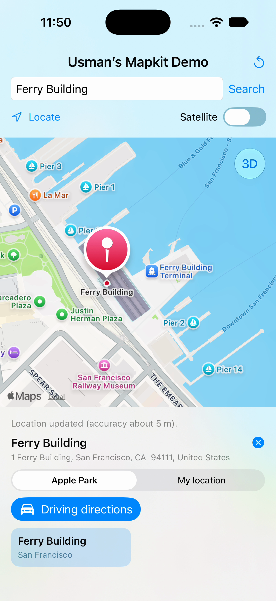
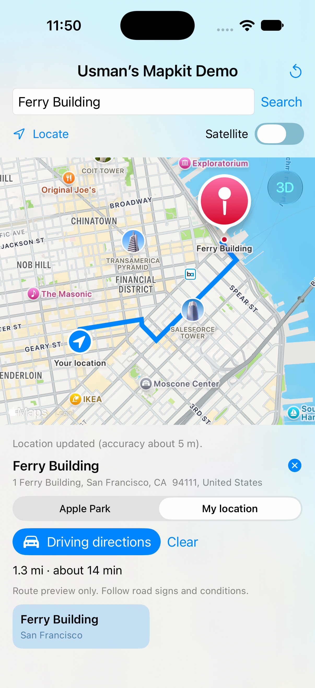
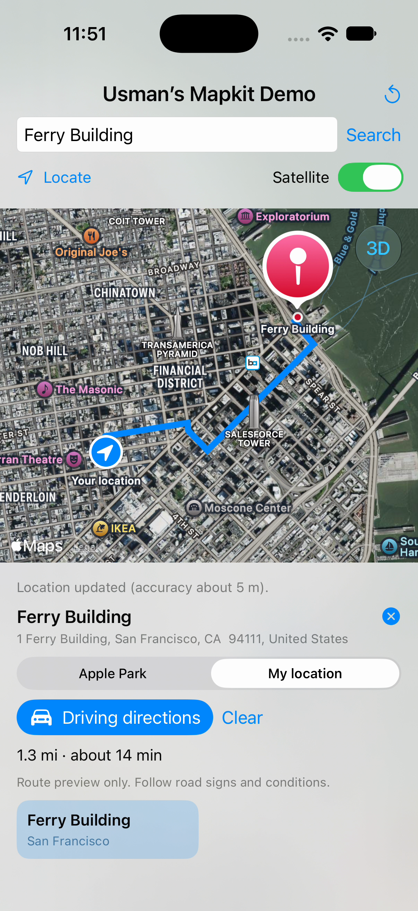

# Usman's Mapkit Demo

A native iOS learning app built with SwiftUI, MapKit, and Core Location. Target: iOS 17+.

## Screenshots and demo

[Download the demo video](demo.mp4) — a **36-second captioned walkthrough** of Locate, Ferry Building search, tapping its map pin, routing from **My location**, and satellite imagery, followed by a closing card. No narration.

**The San Francisco location is simulated.** Location permission was already granted when the video was recorded. The accuracy message reflects the simulator's supplied fix, not a measurement of real GPS performance.

| Select the Ferry Building pin | Route from My location | Satellite route |
| --- | --- | --- |
|  |  |  |

## Follow the demo

1. Open `MiniMaps.xcodeproj` in Xcode, select the **MiniMaps** scheme and an iPhone simulator, and press **Command-R**.
2. In Xcode's debug toolbar, open **Simulate Location** and select **San Francisco, CA, USA**.
3. In the app, tap **Locate**. On first use, allow location access when prompted. Confirm that the location-update message appears.
4. Search for **Ferry Building**.
5. Tap the **Ferry Building map pin** to open its details.
6. Choose **My location** as the route origin.
7. Tap **Driving directions** to display the blue route, distance, and estimated travel time.
8. Turn on **Satellite** to view the same route over imagery.

Search results and route estimates can change. The recorded run returned a 1.3-mile route with an estimate of about 14 minutes; these values are an example, not test assertions.

**If location is denied:** in the simulator's iOS Settings, open **Privacy & Security → Location Services → Usman's Mapkit Demo → While Using the App**. Return to the app and tap Locate. The app refreshes authorization when it becomes active.

**Alternative without location permission:** search for **Apple Infinite Loop**, select its pin or result card, choose **Apple Park**, and tap **Driving directions**. This alternative is supported by the app but is not the flow shown in the latest video.

## Features

- Interactive standard and satellite maps with compass, pitch controls, and reset to Apple Park.
- Place/address search with `MKLocalSearch`, result cards, and selectable map markers.
- On-demand, when-in-use location access, including denied/restricted/unavailable states and timeout handling.
- Driving-route previews with `MKDirections`, `MapPolyline`, distance, and estimated time.
- Route origin choice: a fresh device location or Apple Park as a fixed example origin.
- Cancellable search and direction requests; generation checks prevent obsolete responses replacing newer state.

This app provides **route previews**, without spoken guidance or turn-by-turn navigation. It has no custom backend or location history and requests no background location permission. Search/directions requests use Apple's services.

## Requirements and running

- iOS 17+; an Xcode version with a compatible iOS SDK and simulator runtime.
- No API key is required. Search, directions, and uncached map tiles require network access.
- For a physical iPhone, select your development team under Signing & Capabilities. The device provides its own location; the simulator instructions above apply to the recorded demo only.

## Code guide

- `MiniMapsApp.swift`: application entry point.
- `ContentView.swift`: map rendering, search controls, marker selection, route presentation, and foreground authorization refresh.
- `MapModel.swift`: main-actor UI state, cancellable search/directions, Core Location authorization, and one-shot location fixes.
- `MiniMapsTests/MapModelTests.swift`: deterministic XCTest coverage using injected search/directions services.

`MKLocalSearch.Request.region` biases relevance without restricting results to the visible region. Each query creates a fresh search object. `MKDirections` returns a route whose geometry is drawn with `MapPolyline`. Core Location authorization is requested after a Locate tap; returning from Settings refreshes state without implicitly requesting a fix.

Apple documentation: [MapKit](https://developer.apple.com/documentation/mapkit/), [MKLocalSearch](https://developer.apple.com/documentation/mapkit/mklocalsearch), [MKDirections](https://developer.apple.com/documentation/mapkit/mkdirections), [Core Location](https://developer.apple.com/documentation/corelocation/cllocationmanager).

## Automated unit tests

Press **Command-U** with the MiniMaps scheme selected. **16 XCTest tests passed with zero failures** on iPhone 18 Pro / iOS 27.0, using Xcode 27.1 on October 25, 2026.

Tests cover blank/trimmed queries, regional search hints, successful/empty/failed search responses, recovery, cancellation and late responses, route origin selection, missing/stale location fixes, route errors, destination/origin changes, and authorization grant/revocation state. Search and directions are replaced by controlled test doubles; these tests do not validate live Apple service results or real GPS behavior.

## Verification and limits

The latest video demonstrates a simulated location update, Ferry Building search, map-pin selection, My location routing, and satellite presentation. Permission prompting, denied access, and recovery after a Settings change were checked separately; they are not all shown in the video.

Approximate location, restricted device policy, real offline transitions, accessibility extremes, real-device GPS performance, and exhaustive cancellation timing remain integration/device checks. Successful route presentation was verified in the simulator rather than through a deterministic unit test.

See [the test plan and evidence](TESTING.md) for the complete matrix, automated results, and observed checks.
